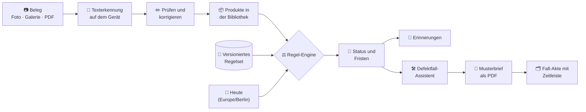
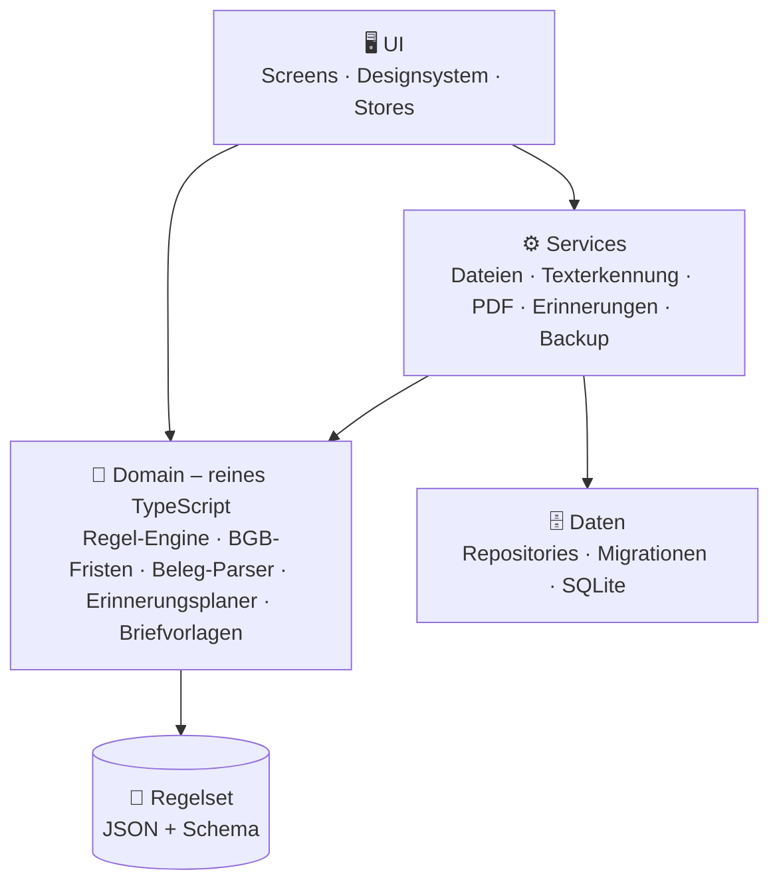

<div align="center">

# 🧭 Reparatur-Kompass

**Belege, Gewährleistung, Garantie und Recht auf Reparatur – übersichtlich auf deinem Handy.**

Eine local-first App für Android und iOS, die dir zeigt, welche Ansprüche du bei einem gekauften Produkt voraussichtlich noch hast und was du im Defektfall als Nächstes tun kannst.


</div>

> [!IMPORTANT]
> Der Reparatur-Kompass bietet **Rechtsinformation und Musterschreiben, keine Rechtsberatung**. Alle Einschätzungen sind „voraussichtlich" und beruhen auf den in der App hinterlegten Regeln.

---

## Inhalt

- [Worum geht es?](#worum-geht-es)
- [Funktionen](#funktionen)
- [So funktioniert es](#so-funktioniert-es)
- [Rechtlicher Hintergrund](#rechtlicher-hintergrund)
- [Datenschutz](#datenschutz)
- [Technik](#technik)
- [Qualität und Tests](#qualität-und-tests)
- [Projektstatus](#projektstatus)
- [Über dieses Repository](#über-dieses-repository)
- [English summary](#english-summary)

---

## Worum geht es?

Wenn etwas kaputtgeht, stellen sich fast immer dieselben Fragen:

- **„Habe ich überhaupt noch Anspruch – und gegen wen?"**
- **„Wo ist der Kassenbon?"**
- **„Lohnt sich eine Reparatur, oder gebe ich das Gerät einfach auf?"**

Reine Beleg-Tresore speichern nur Ablaufdaten. Der Reparatur-Kompass geht weiter:

| | Was die App macht |
| --- | --- |
| ⚖️ **Regel-Engine** | Berechnet für jedes Produkt Fristen und mögliche Anspruchswege nach deutschem Recht – inklusive des neuen Reparaturanspruchs gegen Hersteller (§§ 479a ff. BGB). |
| 🛠️ **Defektfall-Assistent** | Führt Schritt für Schritt durch den Defekt: voraussichtlich bester Weg, Fristen, Musterbrief als PDF und eine Fall-Akte mit Zeitleiste. |
| 🔒 **Datenschutz** | Alles bleibt auf deinem Gerät. Kein Konto, kein Server, keine Werbung, keine Tracker. |

---

## Funktionen

### 📥 Belege erfassen
- Kassenbon mit der **Kamera** fotografieren, Bild aus der **Galerie** wählen oder eine **PDF-Rechnung** importieren
- **Texterkennung direkt auf dem Gerät** schlägt Händler, Kaufdatum, Summe und einzelne Positionen vor – du prüfst und korrigierst
- **Ein Beleg, mehrere Produkte:** Ein Einkauf kann mehrere Produkte enthalten
- Ablieferungsdatum getrennt vom Kaufdatum (wichtig bei Online-Bestellungen)
- **Herstellergarantie** mit Dauer, Garantiegeber und Foto der Garantiekarte
- Ohne Texterkennung bleibt alles per Hand eingebbar

### 📚 Bibliothek
- Alle Produkte mit **Suche**, **Statusfilter** und **Sortierung nach der nächsten Frist**
- **Status-Chips** mit Text und Symbol – nie nur über Farbe
- Produktdetail mit **Zeitstrahl**: Kauf, Ablieferung, Ende der Beweislastumkehr, Ende der Gewährleistung, Garantieende
- Zu jeder Einschätzung ein **„Warum?"** mit Begründung und Gesetzesquelle

### 🔔 Erinnerungen
- **Lokale Benachrichtigungen** vor wichtigen Fristen, zum Beispiel 90, 30 und 7 Tage vor dem Ende der Gewährleistung
- Global und pro Produkt abschaltbar
- Kluge Priorisierung, weil iOS nur 64 geplante Benachrichtigungen erlaubt

### 🛠️ Defektfall-Assistent
```
Produkt wählen → Defekt beschreiben → Ergebnis mit „Warum?" → Wunsch (Reparatur / Ersatz)
→ Briefvorschau (bearbeitbar) → PDF erstellen und teilen → Fall-Akte
```
- **Musterbriefe** an den Verkäufer (Mängelanzeige), den Garantiegeber (Garantiefall) oder den Hersteller (Reparaturverlangen nach § 479b BGB)
- **Fall-Akte** mit Zeitleiste: Brief versendet, Antwort erhalten, Reparatur, Rückgabe, Abschluss – inklusive Anhängen und Folge-Erinnerungen
- Export der gesamten Akte als PDF

### 🗂️ Deine Daten gehören dir
- **Backup und Wiederherstellung** als ZIP-Datei, inklusive aller Fotos und PDFs
- **„Alle Daten löschen"** mit einem Tipp
- Optionale **App-Sperre** per Face ID, Fingerabdruck oder Gerätecode

---

## So funktioniert es



Der Status eines Produkts wird **nie gespeichert**, sondern bei jedem Aufruf neu berechnet – aus den erfassten Fakten, dem heutigen Datum und dem hinterlegten Regelset. So bleibt die Anzeige automatisch aktuell, und eine Regeländerung wirkt sofort auf alle Produkte.

Die Engine kennt dabei mehr als nur „aktiv" oder „abgelaufen":

| Zustand | Bedeutung |
| --- | --- |
| `upcoming` | beginnt erst später (z. B. der Reparaturanspruch gegen den Hersteller nach Ende der Gewährleistung) |
| `active` | läuft |
| `expiring_soon` | endet bald |
| `expired` | abgelaufen |
| `not_applicable` | trifft auf dieses Produkt nicht zu |
| `unknown` | lässt sich nach den hinterlegten Regeln nicht sicher sagen – die App formuliert dann neutral |

---

## Rechtlicher Hintergrund

Die App berücksichtigt unter anderem diese Regeln des deutschen Verbrauchsgüterkaufs:

| Thema | Kurz erklärt | Grundlage |
| --- | --- | --- |
| **Gewährleistung** | 2 Jahre ab **Ablieferung** der Ware (bei gebrauchter Ware unter Umständen 1 Jahr) | § 438, § 476 BGB |
| **Beweislastumkehr** | Zeigt sich ein Mangel im ersten Jahr, wird vermutet, dass er schon bei Übergabe da war | § 477 BGB |
| **Herstellergarantie** | Freiwillig, zusätzlich zur Gewährleistung – nie stattdessen | § 443 BGB |
| **Verlängerung bei Reparatur** | Wird ein Mangel per Reparatur behoben, verlängert sich die Gewährleistung einmalig um 12 Monate (Kaufverträge ab 31.07.2026) | § 475e Abs. 5 BGB, Art. 229 § 72 EGBGB |
| **Reparaturanspruch gegen den Hersteller** | Für bestimmte Produktgruppen (z. B. Smartphones und Tablets), wenn gegen den Verkäufer keine Mängelrechte (mehr) bestehen – auch gegen angemessenes Entgelt | §§ 479a ff. BGB (Umsetzung der Richtlinie (EU) 2024/1799) |

**Fristen nach §§ 187, 188 BGB statt Kalender-Bauchgefühl.** Ein Beispiel: Wurde ein Gerät am 29.02.2024 geliefert, gibt es den 29.02.2026 nicht – die zweijährige Frist endet deshalb am **28.02.2026**. Solche Fälle (Schaltjahre, Monatsenden, Jahreswechsel, Stichtage) sind in der Engine fest abgedeckt und getestet.

**Regeln sind Daten, kein Code.** Alle Regeln liegen in einer versionierten JSON-Datei, die gegen ein Schema geprüft wird. Jede Regel trägt:

- einen erklärenden Text für das „Warum?",
- ihre **Quellen** (bevorzugt Primärquellen wie gesetze-im-internet.de),
- ein Datum der letzten Prüfung und ab wann sie gilt,
- ein Kennzeichen **`verified`**, ob sie bereits bestätigt ist.

Was nicht sicher belegt ist, wird nicht geraten: Es bleibt als `unknown` bzw. `verified: false` markiert und wird in der App vorsichtig formuliert. Einzelne Auslegungsfragen, die vollständige Liste der erfassten Produktgruppen und die Musterbriefe sollen **vor einer Veröffentlichung juristisch geprüft** werden.

---

## Datenschutz

- 🚫 **Kein Konto, kein Backend, keine Cloud** – die App funktioniert vollständig offline
- 🚫 **Keine Analyse-Tools, keine Absturzberichte an Dritte, keine Werbung, keine Tracker**
- 📱 **Texterkennung auf dem Gerät** (Android: Google ML Kit, iOS: Apple Vision) – Belegbilder verlassen das Handy nicht
- 🔔 **Nur lokale Benachrichtigungen**, keine Push-Server
- 📤 **Teilen nur auf deinen Wunsch** über das System-Teilen-Menü (z. B. ein Brief-PDF)
- 💾 **Backup in deiner Hand:** Die ZIP-Datei legst du selbst ab, wo du willst

---

## Technik

| Bereich | Umsetzung |
| --- | --- |
| App-Framework | [Expo](https://expo.dev) SDK 58, React Native, React 19 |
| Sprache | TypeScript im `strict`-Modus |
| Navigation | expo-router (dateibasiert) |
| Datenhaltung | SQLite (expo-sqlite) mit versionierten Migrationen |
| Validierung | [zod](https://zod.dev) für alle externen Eingaben (Texterkennung, Backups, Regelsets) |
| Zustand | [Zustand](https://github.com/pmndrs/zustand) für UI-Zustand |
| Texterkennung | on-device (ML Kit / Apple Vision) |
| PDF und Teilen | expo-print, expo-sharing |
| Backup | ZIP per Streaming – auch große Fotosammlungen ohne hohen Speicherbedarf |
| Tests | Jest, React Native Testing Library, fast-check, Stryker, Maestro |

### Architektur



Leitlinien:

- **Die Domain-Schicht ist frei von React, Expo und Datenbank** – das wird per Lint-Regel erzwungen. Dadurch lässt sich die gesamte Rechtslogik schnell und vollständig testen.
- **Screens enthalten keine Geschäftslogik.**
- **Datumswerte als `YYYY-MM-DD`**, „heute" immer über eine eigene Uhr in der Zeitzone Europe/Berlin – keine Zeitzonenfallen bei Fristen.
- **Geldbeträge als ganze Cent**, IDs als UUID, Dateien nur mit relativen Pfaden.
- **Alle Texte zentral** an einer Stelle – vorbereitet für weitere Sprachen.

---

## Qualität und Tests

Weil die App Rechtsfristen berechnet, bestimmt das **Risiko** die Testtiefe: Am gründlichsten getestet ist die reine Logik, in der falsche Ergebnisse am meisten kosten würden.

- ✅ **Über 1.000 automatisierte Tests** – Domain, Daten, Services und Bildschirme (Android- und iOS-Plattform)
- 📐 **Golden Vectors:** feste Referenzfälle für die Fristberechnung
- 🎲 **Property-based Testing** mit fast-check, z. B. Determinismus und Zeitzonen-Unabhängigkeit
- 🌍 **Zeitzonen-Matrix:** Die Domain-Tests laufen unter mehreren Zeitzonen (von Los Angeles bis Auckland); dazu eigene Testfälle für die Sommerzeit-Umstellung
- 🧬 **Mutation-Testing** der Domain-Logik mit Stryker (zuletzt gemessen: rund 82 %)
- 📱 **End-to-End-Flows** mit Maestro im Android-Emulator
- ♿ **Barrierefreiheit:** Kontrast aller Farbpaare in Hell und Dunkel mindestens 4,5 : 1 (automatisch geprüft), Rollen und Labels an allen Bedienelementen, große Systemschrift wird unterstützt, Touch-Ziele mindestens 48 dp
- 🔁 **Qualitäts-Gate** aus Typecheck, Lint und Tests, lokal und in der CI
- 🧪 **Nur synthetische Testdaten** – keine echten Belege oder personenbezogenen Daten

---

## Projektstatus

Der Funktionsumfang des MVP ist umgesetzt, die App befindet sich in einer ausführlichen **Testphase**. Sie ist **noch nicht in den App Stores** erhältlich.

| Meilenstein | Inhalt | Stand |
| --- | --- | --- |
| M0 | Fundament: Projekt, Tooling, CI | ✅ |
| M1 | Regel-Engine und BGB-Fristen | ✅ |
| M2 | Datenbank, Bibliothek, Onboarding, Designsystem (Hell/Dunkel) | ✅ |
| M3 | Beleg-Erfassung mit Texterkennung | ✅ |
| M4 | Erinnerungen | ✅ |
| M5 | Defektfall-Assistent, Musterbriefe, Fall-Akte | ✅ |
| M6 | Backup, Barrierefreiheit, App-Sperre, Release-Vorbereitung | ✅ |
| – | Teststrategie und Testphase | 🔄 läuft |

**Als Nächstes geplant:**

- [ ] Juristische Prüfung der noch nicht bestätigten Regeln und der Musterbriefe
- [ ] Belegerkennung weiter verbessern
- [ ] iOS-Build
- [ ] Veröffentlichung in Google Play und im App Store

**Ideen für später (optional):** Belege direkt aus anderen Apps teilen; KI-gestütztes Auslesen von Belegen – nur als freiwillige Zusatzfunktion mit ausdrücklicher Einwilligung, die App bleibt ohne sie voll nutzbar.

---

## Über dieses Repository

Dieses Repository stellt das Projekt vor. Der Quellcode der App ist hier derzeit nicht enthalten.

„Reparatur-Kompass" ist ein Arbeitstitel.

---

## Haftungsausschluss

Der Reparatur-Kompass ersetzt keine Rechtsberatung im Einzelfall. Alle Angaben beruhen auf den hinterlegten Regeln mit dem jeweils angegebenen Prüfstand und können unvollständig sein oder sich durch Gesetzgebung und Rechtsprechung ändern. Musterschreiben sind vor dem Versand selbst zu prüfen. Im Zweifel helfen Verbraucherzentralen oder eine Anwältin bzw. ein Anwalt weiter.

---

## English summary

**Reparatur-Kompass** ("Repair Compass") is a local-first mobile app (Android and iOS, built with Expo and TypeScript) for consumers in Germany. Scan receipts on-device, keep your purchases in a personal library and see, for each product, the estimated status of the statutory warranty, the reversal of the burden of proof, manufacturer guarantees and the new EU right to repair (implemented in §§ 479a ff. of the German Civil Code). When something breaks, a guided assistant suggests the likely best route, generates a template letter as a PDF and keeps a case file with a timeline. No account, no backend, no trackers – all data stays on the device. The app provides legal information, not legal advice.
