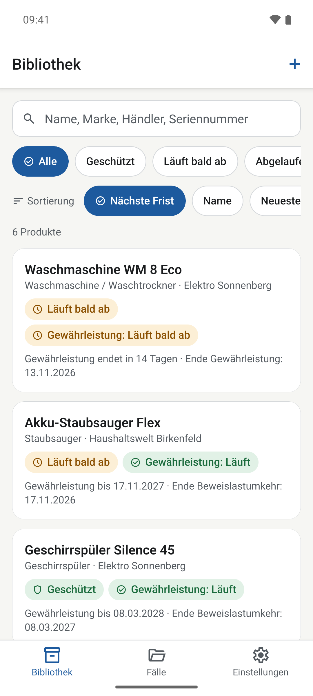
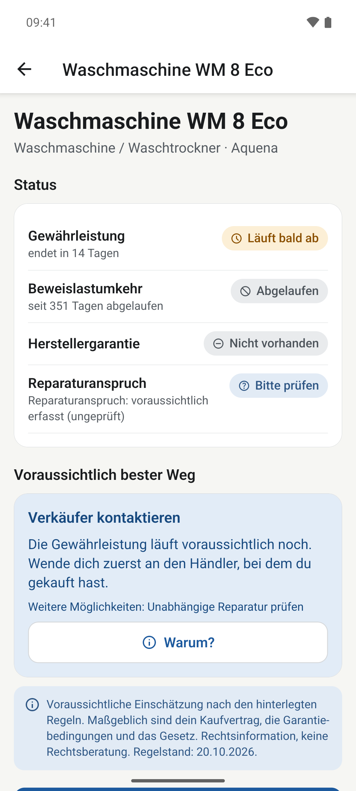
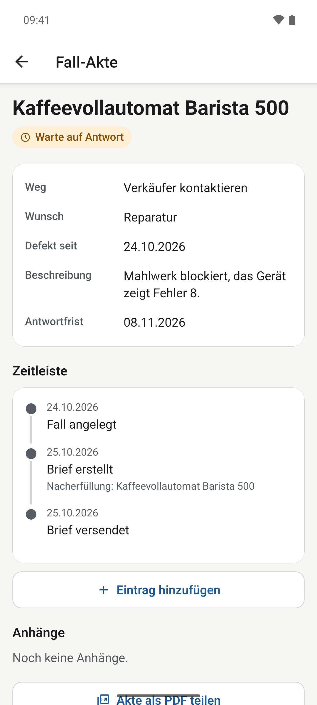
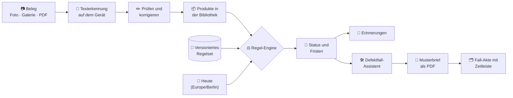
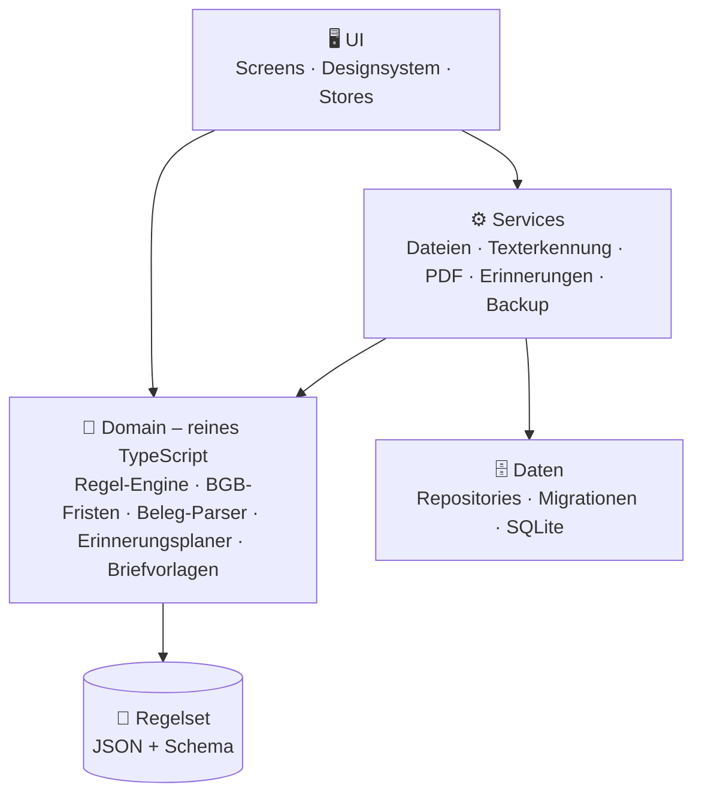

<div align="center">

# 🧭 Reparatur-Kompass

**Belege, Gewährleistung, Garantie und Recht auf Reparatur – übersichtlich auf deinem Handy.**

Eine local-first App für Verbraucher in Deutschland, die dir zeigt, welche Ansprüche du bei einem gekauften Produkt voraussichtlich noch hast und was du im Defektfall als Nächstes tun kannst.

**🌐 Website und Download: [app.elias-nein.com](https://app.elias-nein.com)**

[](https://app.elias-nein.com)

-blue)


</div>

> [!IMPORTANT]
> Der Reparatur-Kompass bietet **Rechtsinformation und Musterschreiben, keine Rechtsberatung**. Alle Einschätzungen sind „voraussichtlich“ und beruhen auf den in der App hinterlegten Regeln.

---

## Inhalt

- [Worum geht es?](#worum-geht-es)
- [Screenshots](#screenshots)
- [Funktionen](#funktionen)
- [So funktioniert es](#so-funktioniert-es)
- [Rechtlicher Hintergrund](#rechtlicher-hintergrund)
- [Datenschutz](#datenschutz)
- [Technik](#technik)
- [Qualität und Tests](#qualität-und-tests)
- [Die Website](#die-website)
- [Projektstatus](#projektstatus)
- [Über dieses Repository](#über-dieses-repository)
- [English summary](#english-summary)

---

## Worum geht es?

Wenn etwas kaputtgeht, stellen sich fast immer dieselben Fragen:

- **„Habe ich überhaupt noch Anspruch – und gegen wen?“**
- **„Wo ist der Kassenbon?“**
- **„Lohnt sich eine Reparatur, oder gebe ich das Gerät einfach auf?“**

Reine Beleg-Tresore speichern nur Ablaufdaten. Der Reparatur-Kompass geht weiter:

| | Was die App macht |
| --- | --- |
| ⚖️ **Regel-Engine** | Berechnet für jedes Produkt Fristen und mögliche Anspruchswege nach deutschem Recht – inklusive des neuen Reparaturanspruchs gegen Hersteller (§§ 479a ff. BGB). |
| 🛠️ **Defektfall-Assistent** | Führt Schritt für Schritt durch den Defekt: voraussichtlich bester Weg, Fristen, Musterbrief als PDF und eine Fall-Akte mit Zeitleiste. |
| 🔒 **Datenschutz** | Alles bleibt auf deinem Gerät. Kein Konto, kein Server des Anbieters, keine Werbung, keine Tracker. |

---

## Screenshots

<div align="center">

| 📚 Bibliothek | 🔎 Produktdetail | 🗂️ Fall-Akte |
| :---: | :---: | :---: |
|  |  |  |
| Alle Produkte mit Status-Chips, sortiert nach der nächsten Frist | Status je Anspruch und der voraussichtlich beste Weg mit „Warum?“ | Defektfall mit Antwortfrist und Zeitleiste |

<sub>Alle gezeigten Produkte, Händler und Daten sind synthetische Testdaten. Weitere Bilder auf der <a href="https://app.elias-nein.com">Website</a>.</sub>

</div>

---

## Funktionen

### 📥 Belege erfassen
- Kassenbon mit der **Kamera** fotografieren, Bild aus der **Galerie** wählen oder eine **PDF-Rechnung** importieren
- **Texterkennung auf dem Gerät** schlägt Händler, Kaufdatum, Summe und einzelne Positionen vor – du prüfst und korrigierst. Auf Android nur nach Einwilligung (Google ML Kit), sonst trägst du alles per Hand ein
- **Ein Beleg, mehrere Produkte:** Ein Einkauf kann mehrere Produkte enthalten
- Plausibilitätsprüfung des Kaufdatums (nicht erkannt, älter als zwei Jahre, in der Zukunft)
- Ablieferungsdatum getrennt vom Kaufdatum (wichtig bei Online-Bestellungen)
- **Herstellergarantie** mit Dauer, Garantiegeber und Foto der Garantiekarte

### 📚 Bibliothek
- Alle Produkte mit **Suche**, **Statusfilter** und **Sortierung nach der nächsten Frist**
- **Status-Chips** mit Text und Symbol – nie nur über Farbe
- Produktdetail mit **Zeitstrahl**: Kauf, Ablieferung, Ende der Beweislastumkehr, Ende der Gewährleistung, Garantieende
- Zu jeder Einschätzung ein **„Warum?“** mit Begründung und Gesetzesquelle

### 🔔 Erinnerungen
- **Lokale Benachrichtigungen** vor wichtigen Fristen, zum Beispiel 90, 30 und 7 Tage vor dem Ende der Gewährleistung, und vor Antwortfristen in Fällen
- Global und pro Produkt abschaltbar; auf dem Sperrbildschirm ohne Produktnamen
- Priorisierung und Zusammenführung, weil iOS nur 64 geplante Benachrichtigungen erlaubt; Abgleich per Diff mit deterministischen IDs

### 🛠️ Defektfall-Assistent
```
Produkt wählen → Defekt beschreiben → Ergebnis mit „Warum?“ → Wunsch (Reparatur / Ersatz)
→ Briefvorschau (bearbeitbar) → PDF erstellen und teilen → Fall-Akte
```
- **Musterbriefe** an den Verkäufer (Mängelanzeige), den Garantiegeber (Garantiefall) oder den Hersteller (Reparaturverlangen nach § 479b BGB)
- **Fall-Akte** mit Zeitleiste: Fall angelegt, Brief erstellt, Brief versendet, Antwort erhalten, Notizen – mit Anhängen und Erinnerungen an die Antwortfrist
- Export der gesamten Akte als PDF; unterbrochene Assistenten und Briefe werden als Entwurf wiederhergestellt

### 🗂️ Deine Daten gehören dir
- **Backup und Wiederherstellung** als ZIP-Datei, inklusive aller Fotos und PDFs
- **„Alle Daten löschen“** mit einem Tipp
- Optionale **App-Sperre** per Fingerabdruck, Face ID oder Gerätecode

---

## So funktioniert es



Der Status eines Produkts wird **nie gespeichert**, sondern bei jedem Aufruf neu berechnet – aus den erfassten Fakten, dem heutigen Datum und dem hinterlegten Regelset. So bleibt die Anzeige automatisch aktuell, und eine Regeländerung wirkt sofort auf alle Produkte.

Die Engine kennt dabei mehr als nur „aktiv“ oder „abgelaufen“:

| Zustand | Bedeutung |
| --- | --- |
| `upcoming` | beginnt erst später (z. B. der Reparaturanspruch gegen den Hersteller nach Ende der Gewährleistung) |
| `active` | läuft |
| `expiring_soon` | endet bald |
| `expired` | abgelaufen |
| `not_applicable` | trifft auf dieses Produkt nicht zu |
| `unknown` | lässt sich nach den hinterlegten Regeln nicht sicher sagen – die App formuliert dann neutral |

---

## Rechtlicher Hintergrund

Die App berücksichtigt unter anderem diese Regeln des deutschen Verbrauchsgüterkaufs (Regelstand der Recherche: 20.10.2026):

| Thema | Kurz erklärt | Grundlage |
| --- | --- | --- |
| **Gewährleistung** | 2 Jahre ab **Ablieferung** der Ware (bei gebrauchter Ware unter Umständen 1 Jahr) | § 438, § 476 BGB |
| **Beweislastumkehr** | Zeigt sich ein Mangel im ersten Jahr, wird vermutet, dass er schon bei Übergabe da war | § 477 BGB |
| **Herstellergarantie** | Freiwillig, zusätzlich zur Gewährleistung – nie stattdessen | § 443 BGB |
| **Mindestlaufzeiten** | 4 Monate nach Auftreten eines Mangels, 2 Monate nach Rückgabe der reparierten oder ersetzten Ware | § 475e Abs. 3, 4 BGB |
| **Verlängerung bei Reparatur** | Wird ein Mangel per Reparatur behoben, verlängert sich die Gewährleistung einmalig um 12 Monate (Kaufverträge ab 31.07.2026) | § 475e Abs. 5 BGB, Art. 229 § 72 EGBGB |
| **Reparaturanspruch gegen den Hersteller** | Für bestimmte Produktgruppen (z. B. Smartphones und Tablets), wenn gegen den Verkäufer keine Mängelrechte (mehr) bestehen – auch gegen angemessenes Entgelt | §§ 479a ff. BGB (Umsetzung der Richtlinie (EU) 2024/1799) |

**Fristen nach §§ 187, 188 BGB statt Kalender-Bauchgefühl.** Ein Beispiel: Wurde ein Gerät am 29.02.2024 geliefert, gibt es den 29.02.2026 nicht – die zweijährige Frist endet deshalb am **28.02.2026**. Die Engine rechnet mit ganzzahligen Tagesnummern statt mit `Date`-Objekten; Schaltjahre, Monatsenden, Jahreswechsel und Stichtage sind fest abgedeckt und getestet.

**Regeln sind Daten, kein Code.** Alle Regeln liegen in einer versionierten JSON-Datei, die gegen ein Schema geprüft wird (das JSON-Schema wird aus dem zod-Schema erzeugt, ein Test hält beide synchron). Jede Regel trägt:

- einen erklärenden Text für das „Warum?“,
- ihre **Quellen** (bevorzugt Primärquellen wie gesetze-im-internet.de),
- ein Datum der letzten Prüfung und ab wann sie gilt,
- ein Kennzeichen **`verified`**, ob sie bereits bestätigt ist.

Was nicht sicher belegt ist, wird nicht geraten: Es bleibt als `unknown` bzw. `verified: false` markiert und wird in der App vorsichtig formuliert. Einzelne Auslegungsfragen, die vollständige Liste der erfassten Produktgruppen und die Musterbriefe sollen **vor einer Veröffentlichung im Store juristisch geprüft** werden.

---

## Datenschutz

- 🚫 **Kein Konto, kein Backend, keine Cloud** – die App arbeitet vollständig auf dem Gerät
- 🚫 **Keine Analyse-, Tracking- oder Absturzberichtswerkzeuge des Anbieters, keine Werbung**
- 📱 **Texterkennung auf dem Gerät:** iOS mit Apple Vision; Android mit Google ML Kit **nur nach Einwilligung** (jederzeit widerrufbar). Belegbilder und erkannter Text bleiben auf dem Gerät; ML Kit sendet laut Google technische Nutzungsdaten (z. B. Gerätemodell, Leistungswerte) an Google
- 🔔 **Nur lokale Benachrichtigungen**, keine Push-Server
- 📤 **Teilen nur auf deinen Wunsch** über das System-Teilen-Menü (z. B. ein Brief-PDF)
- 💾 **Backup in deiner Hand:** Die ZIP-Datei legst du selbst ab, wo du willst
- 🛡️ **Android-Härtung:** kein automatisches Cloud-Backup und keine Geräte-zu-Gerät-Übertragung der App-Daten, keine Vorschau im App-Umschalter, nicht benötigte Berechtigungen (Mikrofon, Speicher, Medien, Overlay) blockiert

Die vollständige Datenschutzerklärung steht in der App und auf der [Website](https://app.elias-nein.com/datenschutz/).

---

## Technik

| Bereich | Umsetzung |
| --- | --- |
| App-Framework | [Expo](https://expo.dev) SDK 58, React Native 0.88, React 19.3 |
| Sprache | TypeScript 6 im `strict`-Modus |
| Navigation | expo-router (dateibasiert) |
| Datenhaltung | SQLite (expo-sqlite) mit versionierten Migrationen und eingefrorenen Schema-Fixtures |
| Validierung | [zod](https://zod.dev) 4 für alle externen Eingaben (Texterkennung, Backups, Regelsets, Entwürfe) |
| Zustand | [Zustand](https://github.com/pmndrs/zustand) 5 für UI-Zustand; Status wird in Hooks berechnet, nie gespeichert |
| Texterkennung | on-device (ML Kit / Apple Vision), eigener Beleg-Parser in reinem TypeScript |
| PDF und Teilen | expo-print, expo-sharing |
| Backup | ZIP mit fflate, gestreamt; Import validiert Manifest, Schemaversion und alle Datensätze |
| Benachrichtigungen | expo-notifications, nur lokal (Datums-Trigger) |
| Build | EAS Build (Profile `preview`, `production`, `e2e`), Config-Plugins für Android-Manifest und Datenregeln |
| Android | App-ID `io.github.eliasnein.reparaturkompass`, minSdk 24 (Android 7.0), targetSdk 36 |
| Tests | Jest 30, React Native Testing Library, fast-check, Stryker, Maestro |

### Architektur



Leitlinien:

- **Die Domain-Schicht ist frei von React, Expo und Datenbank** – das wird per Lint-Regel erzwungen. Dadurch lässt sich die gesamte Rechtslogik schnell und vollständig testen.
- **Screens enthalten keine Geschäftslogik.**
- **Datumswerte als `YYYY-MM-DD`**, „heute“ immer über eine eigene Uhr in der Zeitzone Europe/Berlin – keine Zeitzonenfallen bei Fristen.
- **Geldbeträge als ganze Cent**, IDs als UUID, Dateien nur mit relativen Pfaden.
- **Native Module hinter Adaptern** (Dateien, OCR, PDF, Teilen, Benachrichtigungen), damit sie in Tests ersetzbar sind.
- **Alle Texte zentral** an einer Stelle – vorbereitet für weitere Sprachen.

---

## Qualität und Tests

Weil die App Rechtsfristen berechnet, bestimmt das **Risiko** die Testtiefe: Am gründlichsten getestet ist die reine Logik, in der falsche Ergebnisse am meisten kosten würden.

| Prüfung | Ergebnis (Stand 20.11.2026) |
| --- | --- |
| ✅ Automatisierte Tests | **1547 Tests in 62 Suites**, Komponenten und Bildschirme auf iOS- und Android-Plattform |
| 📐 Golden Vectors | **44 feste Referenzfälle** für die Fristberechnung, von Hand gerechnet und mit unabhängiger Implementierung gegengeprüft |
| 🎲 Property-based Testing | fast-check, z. B. Determinismus, Monotonie und Backup-Roundtrip |
| 🌍 Zeitzonen-Matrix | Domain-Tests in 4 Zeitzonen (Los Angeles bis Auckland), **789 Tests mit identischem Ergebnis-Digest**; eigene Fälle für die Sommerzeit |
| 🧬 Mutation-Testing | Stryker auf der Domain-Logik: **87,18 %** |
| 📱 End-to-End | **22 Maestro-Jobs**, jeder 3× hintereinander grün am Release-Build im Android-Emulator |
| 🐒 Robustheit | Monkey-Test am Release-Kandidaten, 3 Seeds × 2000 Ereignisse: **0 Abstürze, 0 ANR** |
| ⚡ Leistung | Kaltstart Median **909 ms**, Speicher nach dem Start rund **126 MB** (Release-Build, 50 Produkte) |
| ♿ Barrierefreiheit | Kontrast aller Farbpaare in Hell und Dunkel mindestens 4,5 : 1 (automatisch geprüft), Rollen und Labels, große Systemschrift, Touch-Ziele mindestens 48 dp, TalkBack-Prüfung |
| 🔁 CI | GitHub Actions bei jedem Push auf `master` und bei Pull Requests: Typecheck, Lint, Tests, Website-Prüfung und Zeitzonen-Matrix |

Dazu: dokumentierte Fehler mit Schweregrad und Regressionstest, explorative Testsitzungen, Release-Prüfung mit festen Gates und **ausschließlich synthetische Testdaten** – keine echten Belege oder personenbezogenen Daten.

---

## Die Website

**[app.elias-nein.com](https://app.elias-nein.com)** stellt die App vor, bietet sie für Android zum Download an und trägt Impressum und Datenschutzerklärungen.

| Bereich | Umsetzung |
| --- | --- |
| Seiten | Statisches HTML, **kein JavaScript, keine Cookies, keine Anfragen an fremde Server**; Systemschrift |
| Bau | Eigenes Node-Skript **ohne Abhängigkeiten**; Entwurf (`noindex`) und Live-Fassung mit Sitemap und Canonical-Links |
| Eine Quelle je Inhalt | Farben aus den Design-Tokens der App (hell und dunkel), Logo als SVG aus derselben Geometrie wie das App-Symbol, Datenschutzerklärung und Impressum wortgleich aus den Texten der App |
| Prüfungen bei jedem Bau | Kontraste von 52 Farbpaaren nach WCAG 2.2 AA, tote Links und Anker, Überschriftenfolge, Sprunglink, keine Skripte oder Inline-Styles (CSP-Verträglichkeit), geschützte E-Mail-Adressen, verbotene Floskeln, Header-Vorlagen gleich der Konfiguration; Gegenprobe mit absichtlich eingebauten Fehlern |
| Barrierefreiheit | axe-core (WCAG 2.2 AA und Best Practices): 0 Verstöße auf allen Seiten im hellen Design, Stichprobe im dunklen; Layout ohne Überlauf von 320 bis 1440 px |
| Sicherheit | Content Security Policy `default-src 'none'`, dazu `X-Frame-Options`, `Referrer-Policy`, `Permissions-Policy`, COOP, CORP, HSTS |
| Screenshots | Aus dem Release-Build im Emulator: Maestro-Flow mit einem Vorführ-Backup aus erfundenen Daten, zugeschnitten als WebP |
| Download | APK mit Größe und SHA-256 auf der Seite |
| Betrieb | Eigener Server mit nginx, nur lokal erreichbar, veröffentlicht über einen Cloudflare Tunnel (kein offener Port); Zugriffsprotokolle ohne IP-Adresse, nach 7 Tagen gelöscht |

---

## Projektstatus

Der Funktionsumfang des MVP ist umgesetzt und die Release-Prüfung abgeschlossen. Die Android-App gibt es derzeit als **Download auf der [Website](https://app.elias-nein.com)**; in Google Play und im App Store ist sie noch nicht.

| Meilenstein | Inhalt | Stand |
| --- | --- | --- |
| M0 | Fundament: Projekt, Tooling, CI | ✅ |
| M1 | Regel-Engine und BGB-Fristen | ✅ |
| M2 | Datenbank, Bibliothek, Onboarding, Designsystem (Hell/Dunkel) | ✅ |
| M3 | Beleg-Erfassung mit Texterkennung | ✅ |
| M4 | Erinnerungen | ✅ |
| M5 | Defektfall-Assistent, Musterbriefe, Fall-Akte | ✅ |
| M6 | Backup, Barrierefreiheit, App-Sperre, Release-Vorbereitung | ✅ |
| – | Teststrategie, Testphase und Release-Prüfung am Release-Build | ✅ 20.11.2026 |
| – | Website mit Download | ✅ 21.11.2026 |
| – | Test mit externen Testerinnen und Testern | 🔄 läuft |

**Als Nächstes geplant:**

- [ ] Juristische Prüfung der noch nicht bestätigten Regeln und der Musterbriefe
- [ ] Veröffentlichung in Google Play
- [ ] iOS-Build
- [ ] Belegerkennung weiter verbessern

Rückmeldungen zum Test sind willkommen – wie, steht auf der [Website](https://app.elias-nein.com/#mitmachen).

---

## Über dieses Repository

Dieses Repository stellt das Projekt vor. Der Quellcode der App ist hier derzeit nicht enthalten. Website: [app.elias-nein.com](https://app.elias-nein.com).

---

## Haftungsausschluss

Der Reparatur-Kompass ersetzt keine Rechtsberatung im Einzelfall. Alle Angaben beruhen auf den hinterlegten Regeln mit dem jeweils angegebenen Prüfstand und können unvollständig sein oder sich durch Gesetzgebung und Rechtsprechung ändern. Musterschreiben sind vor dem Versand selbst zu prüfen. Im Zweifel helfen Verbraucherzentralen oder eine Anwältin bzw. ein Anwalt weiter.

---

## English summary

**Reparatur-Kompass** ("Repair Compass") is a local-first mobile app (built with Expo SDK 58, React Native and strict TypeScript) for consumers in Germany. Scan receipts on-device, keep your purchases in a personal library and see, for each product, the estimated status of the statutory warranty, the reversal of the burden of proof, manufacturer guarantees and the new EU right to repair (implemented in §§ 479a ff. of the German Civil Code). When something breaks, a guided assistant suggests the likely best route, generates a template letter as a PDF and keeps a case file with a timeline. No account, no backend, no trackers – all data stays on the device. The rule engine is pure TypeScript with versioned, schema-checked rule sets and is covered by 1,547 tests, golden vectors, property-based tests, a time-zone matrix and mutation testing (87 %). The Android app is currently available as a download from **[app.elias-nein.com](https://app.elias-nein.com)**; Google Play and iOS are planned. The app provides legal information, not legal advice.
